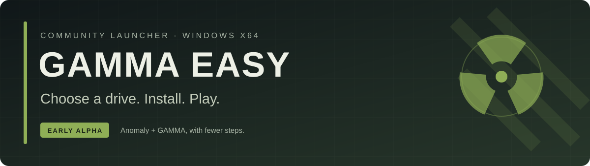
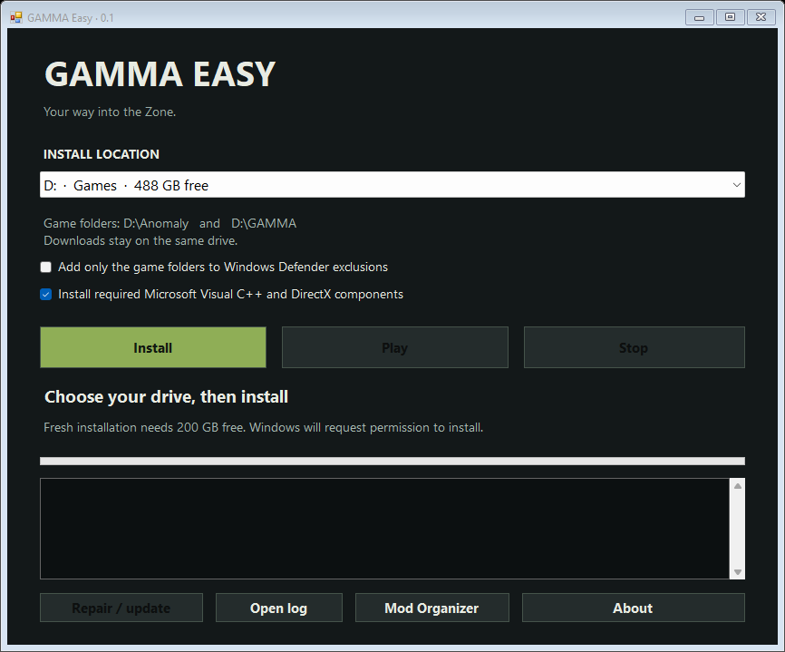

<p align="center">
  
</p>

<p align="center">
  <a href="https://github.com/Nachos0/gamma-easy/actions/workflows/build.yml"></a>
  
  <a href="LICENSE"></a>
  
</p>

<p align="center">
  <a href="https://github.com/Nachos0/gamma-easy/releases"><b>Download</b></a> ·
  <a href="docs/INSTALLATION.md">Install guide</a> ·
  <a href="docs/TROUBLESHOOTING.md">Troubleshooting</a> ·
  <a href="CONTRIBUTING.md">Contribute</a>
</p>

# GAMMA Easy

A small Windows installer and launcher for **S.T.A.L.K.E.R. Anomaly + GAMMA**.
Choose an internal drive, let it handle the downloads and setup, then launch the
game through Mod Organizer 2.

**Early alpha:** 36 isolated checks passed, and the first real installation reached
the game world, confirmed by the user on 2026-10-09. Extended gameplay and other
Windows configurations still need testing. See [validation status](docs/TESTING.md). This project is independent
of GAMMA, GSC Game World, and the installer backend's authors.



## What it handles

- **A drive picker that follows the folder rules.** Creates `D:\Anomaly` and
  `D:\GAMMA` at the selected drive's root; checks NTFS, internal drives, and space.
- **Downloads and setup.** Uses the pinned
  [FaithBeam installer](https://github.com/FaithBeam/stalker-gamma-cli) to acquire
  Anomaly, GAMMA components, and mods from their upstream sources and configure MO2.
- **Stop and retry.** Keeps complete downloaded archives and stops backend child
  processes. A partial individual download may restart.
- **Required Microsoft components.** Downloads Visual C++ and DirectX from
  Microsoft, verifies their signatures, and handles restart requirements.
- **An explicit Defender option.** Folder exclusions are optional; antivirus is
  never disabled.
- **Play through MO2.** Checks the installed profile, DX11 entry, required files,
  and enabled mod folders before allowing launch.

The setup contains the launcher and installer engine. **It does not bundle game
files or the modpack.** An existing installation is not imported or overwritten.

## Get started

1. Open [Releases](https://github.com/Nachos0/gamma-easy/releases) and download the
   Windows x64 package.
2. Extract the package, run `GammaSetup.exe`, and click **Install launcher**.
3. Choose an internal NTFS drive with about **200 GB free** and click **Install**.
4. Accept the Windows administrator prompt. When the checks finish, click **Play**.

| Requirement | Supported |
| --- | --- |
| Windows | Windows 10/11, x64 |
| Launcher runtime | .NET Framework 4.8 |
| Game location | Internal NTFS drive; SSD preferred |
| Fresh-install space | About 200 GB free |
| Connection | Internet access to the upstream download providers |

Windows 7, ARM64, USB drives, and existing manual installations are not supported
by this build. The executable is unsigned. Read the
[installation guide](docs/INSTALLATION.md) before testing it.

## Build from source

On Windows x64, open PowerShell in the repository:

```powershell
.\scripts\build.ps1
.\scripts\test.ps1
```

The build fetches a **version-pinned, SHA256-checked** installer backend and embeds
it in `build\GammaSetup.exe`. It uses the .NET Framework compiler supplied with
Windows; no NuGet restore or developer SDK is required for this wrapper.

To assemble an installer ZIP and corresponding source bundle:

```powershell
.\scripts\package.ps1
```

See [development](docs/DEVELOPMENT.md) for the layout, dependency locks, and release
workflow. CI builds and tests the wrapper without downloading the game or
installing Microsoft runtimes.

## Known limits

- The first installation reached the world; extended gameplay and additional machines still need testing.
- Download hosts can fail, throttle, or present bot challenges.
- Retry reuses verified complete archives; universal byte-level resume is not implemented.
- **Repair / update** reapplies the official GAMMA profile and can reset custom mod
  selections and executable entries. The backend is asked to preserve `user.ltx`
  and MCM settings.
- The current UI uses the backend's per-item log and an activity indicator rather
  than a single overall download percentage.
- The launcher has no automatic self-update or Windows uninstall registration yet.

Follow the [roadmap](docs/ROADMAP.md), or
[report a reproducible problem](https://github.com/Nachos0/gamma-easy/issues/new/choose).

**Planned co-op:** optional [xrRazom integration](docs/COOP.md) after the base game
installation is verified, with a reversible Single-player / Co-op mode switch.
The integration and GAMMA tweaks will be worked out and tested later; co-op is not
included in the current release.

## Credits and license

- [Grokitach / STALKER GAMMA](https://github.com/Grokitach/Stalker_GAMMA): modpack,
  definitions, and installation documentation.
- [FaithBeam / stalker-gamma-cli](https://github.com/FaithBeam/stalker-gamma-cli):
  the installation engine. This project builds a Windows GUI around that work.
- The Anomaly team, Mod Organizer 2 contributors, 7-Zip, and the mod authors.
- GSC Game World: the S.T.A.L.K.E.R. universe.

GAMMA Easy is **GPL-3.0-or-later**. The backend and native components retain their
own licenses. See [LICENSE](LICENSE) and
[third-party notices](third-party/NOTICE.md). Release source bundles include the
matching backend and native dependency sources.
